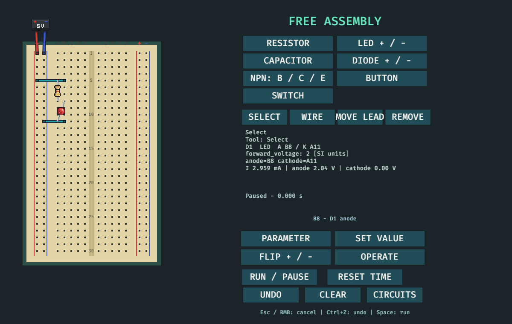

# bredboard

An educational 2D breadboard simulator in Rust and Bevy, with a standalone electrical simulation core.

**Status: MVP complete.** T00–T14 and their accepted dependencies are complete, including the three-circuit Linux app, integrated verification, and the verified Linux release artifact. Work after this boundary is post-MVP and must not reopen MVP scope.

One Bevy app contains the menu, board, controls, and readouts for Linux and WASM. Linux is the MVP interaction target. The same app compiles to WASM, but browser runtime testing is deferred. The MVP has three fixed circuits and no user-facing file workflow or assembly editor. The original MVP boards remain fixed; readable automatic placement is tracked as post-MVP T18. An optional single-board assembly editor is now available (T30; see below).

## Project documents

- [Product and technical plan](docs/PLAN.md)
- [Task index and Codex Goal workflow](docs/TASKS.md)
- [Post-MVP roadmap](docs/roadmap/POST-MVP.md)
- [Contributor guide](CONTRIBUTING.md)
- [Agent instructions](AGENTS.md)

English is the canonical language for documentation, UI, diagnostics, schemas, and commit messages. The window title lives in `crates/app/src/text.rs`; the shared menu and board view live in `crates/app/src/main.rs`.

## Build and verification

Install Rust through [rustup](https://rustup.rs/). `rust-toolchain.toml` pins Rust 1.95.0, rustfmt, Clippy, and `wasm32-unknown-unknown`. The Linux app needs the [Bevy Linux system dependencies](https://bevy.org/learn/quick-start/getting-started/setup/) for its window and renderer. Run these commands from the repository root:

```sh
cargo fmt --all --check
cargo clippy --workspace --all-targets --locked -- -D warnings
cargo test --workspace --locked
cargo build -p bredboard-app --target x86_64-unknown-linux-gnu --locked
cargo build -p bredboard-app --target wasm32-unknown-unknown --locked
```

Run the Linux app with `cargo run -p bredboard-app --locked`. The core can be checked alone with `cargo test -p bredboard-core --locked`; inspect its dependencies with `cargo tree -p bredboard-core --locked`.

Select a circuit from the grouped menu: MVP benches, foundation exercises
E1–E10, switching/timing exercises E11–E20, or advanced exercises E21–E30.
Click a group header to collapse or expand its exercises; long groups start
collapsed so the menu shows as many fixed-height rows as possible at once.
Type letters or digits while the menu is open to filter the catalog; Backspace
removes the last character and Escape clears the filter.
Each bench has Run/Pause, Reset, and its switch or press/release control.
Hover over a hole to read its exact ID and any plugged component pin or wire.
The shown 5 V source connects to the rail holes. Fixed exercises retain their authored layout. Use **EDIT A COPY** for single-board component placement; file controls remain future work.

The core uses exact 100 microsecond electrical steps. The app advances 1,000 such steps per wall-clock second, so the RC change is easy to watch; solver results never depend on rendering frame rate.

Generate the Project JSON Schema with `cargo run -p bredboard-tools --locked -- schema`; validate a project with `cargo run -p bredboard-tools --locked -- validate path/to/project.json`. See [the project format guide](docs/PROJECT-FORMAT.md) for the board contact model and authoring example.

Validate the imported reference-schematic catalog and its separate schema with
`cargo run -p bredboard-tools --locked -- validate-catalog
breadboard-circuits/spec/catalog.json`. The catalog is reference content; its
schematics are not yet runnable fixtures in the app.

Run the resistive DC solver headlessly with `cargo run -p bredboard-tools --locked -- solve path/to/project.json`.

Advance a project by an exact number of 100-microsecond steps with `cargo run -p bredboard-tools --locked -- simulate path/to/project.json 1000`.

Save/validate simulation snapshots and replay action logs with the tools described in [the persistence guide](docs/PERSISTENCE.md).

Run the native MVP transcript and diagnostic verification with `cargo run -p bredboard-tools --locked -- verify-native`. It records the target, Rust version, core versions, and fixed property seed/case count; it exits nonzero on any trace or replay mismatch.

The WASM command above is a compile-only compatibility check. The `web/` page is a canvas and startup wrapper for the same Bevy app; it has no separate product controls. Do not use browser interaction as MVP acceptance evidence. Runtime browser verification belongs to a later deployment phase.

## Licensing

The project is open source under the [MIT License](LICENSE), selected in the initial GitHub commit. Release preparation includes dependency/asset license and attribution review.

[Dependency and embedded font origins, licenses, and notices](docs/DEPENDENCIES.md) are recorded for this workspace.

Repository: [kilatev/bredboard](https://github.com/kilatev/bredboard). The local checkout uses colocated Git/Jujutsu with `origin` set to `git@github.com:kilatev/bredboard.git`. Configure contributor identity at repository scope in both Git and Jujutsu; do not change global identity settings for this project.

## Interactive assembly (post-MVP T30)

Choose **FREE ASSEMBLY** for a standard 30-row board with a 5 V supply, or
**EDIT A COPY** on a single-board exercise. The original fixtures are never
modified. Multi-board catalog exercises remain in their existing fixed view.

- Choose a part, then click its holes in the indicated pin order. Available
  parts: resistor, LED, capacitor, diode, NPN transistor, button and switch.
- **WIRE**: click both endpoints. Crossings do not create electrical nodes.
- **MOVE LEAD**: click a plugged lead, then its new hole (also works for wires).
- **SELECT**: click a part or its lead to inspect parameters and pin voltages.
  **PARAMETER** cycles its numeric parameters; **SET VALUE** accepts a typed SI
  value, such as `1000` ohms or `1e-4` farads. Enter applies, Esc cancels.
- **FLIP + / -** swaps the leads of a selected two-terminal part. **OPERATE**
  changes a selected button/switch using the core's ordinary control actions.
- **REMOVE**: click a part, its lead or a wire. **UNDO** / Ctrl+Z restores the
  preceding accepted project (up to 32 edits). **CLEAR** returns to a bare
  supplied board. Esc or right click cancels an unfinished placement.
- **RUN / PAUSE** / Space advances the same fixed-step core. **RESET TIME**
  resets the latest assembly's simulation, rather than restoring a fixture.

Accepted structural edits restart simulation; invalid structure, occupied
holes and out-of-range parameters leave the project unchanged. An electrically
unsolvable but structurally valid assembly is retained with a calculation
failure diagnostic. No scripted LED results or separate editable netlist are
used. Unsaved assemblies last for the current session only; **CIRCUITS** leaves
the editor and returns to the original catalog.

On slow frames, wall-time catch-up is capped at 50 ms so input remains responsive.
The electrical core still advances consecutive fixed steps; simulation can run
slower than wall time.



[Watch the 40-second native assembly demo](docs/design/assembly/editor-demo.mp4)
