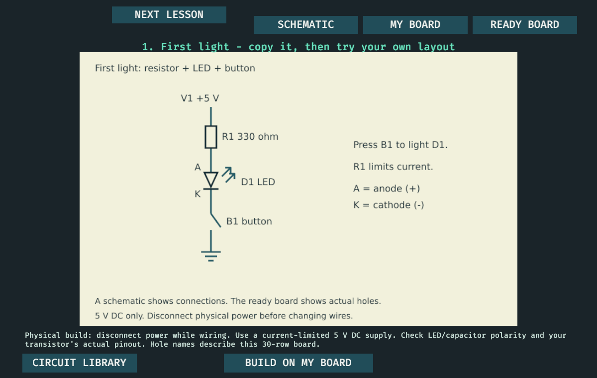
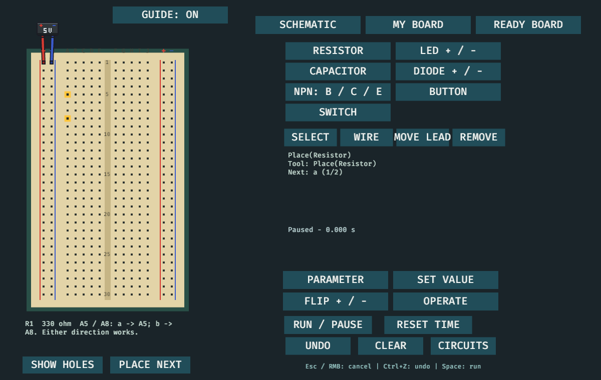
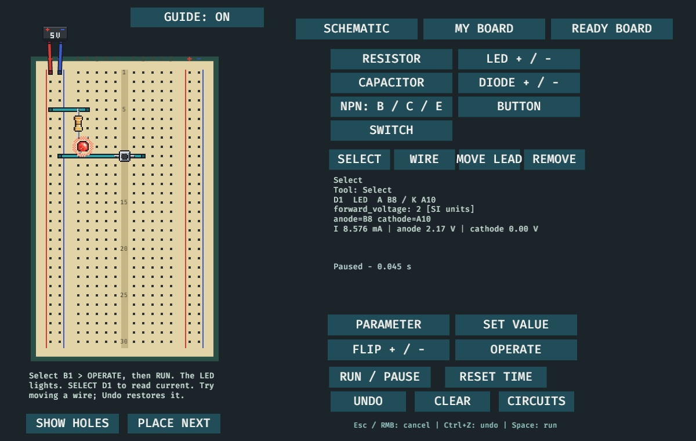

# Beginner assembly path

Choose **START HERE: BUILD & LEARN**. First Light starts with the ready board;
**NEXT LESSON** opens the RC and transistor lessons from their schematics.
**MY BOARD** always contains an independently editable assembly. Looking at
**READY BOARD** or **SCHEMATIC** preserves that assembly, its simulation and Undo.

The optional guide selects the next part/tool and highlights its contacts.
Click those holes to place it yourself, or choose **PLACE NEXT** for one assisted
step. **UNDO** works for both. Exact contacts describe the example; a different
working layout is allowed. No quiz, timer or completion gate blocks progress.







## Source artwork

The three [SVG diagrams](../../../crates/app/assets/learning) are original
MIT-licensed project artwork, matching `led-bench.json`, `rc-bench.json` and
`transistor-bench.json`. The app embeds their checked-in PNG renderings through
existing Bevy image support. No runtime parser or new dependency was introduced.
Regenerate a raster with:

```sh
inkscape crates/app/assets/learning/led.svg --export-type=png \
  --export-filename=crates/app/assets/learning/led.png
```

The SVG expresses electrical connections. The ready board and contact list
express physical placement on this supported 30-row board. Actual component
pinouts and button leg pairs must be checked before copying onto hardware.
